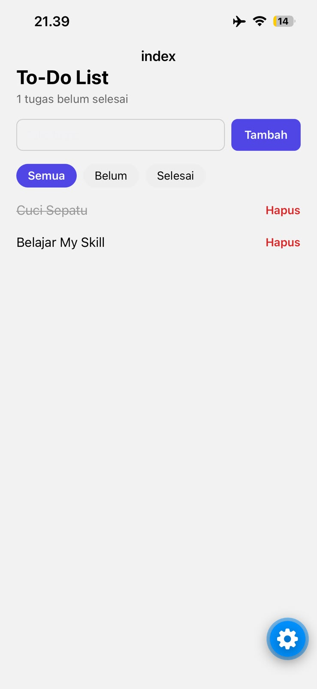

# To-Do List React Native

Aplikasi to-do list sederhana, project pertamaku belajar React Native dengan Expo.

## Fitur

- Tambah, centang, dan hapus tugas
- Edit tugas (tahan lama pada tugas)
- Filter: semua, belum, selesai
- Data tersimpan lokal dengan AsyncStorage

## Tech Stack

- React Native + Expo (Expo Router)
- TypeScript
- AsyncStorage

## Cara Menjalankan

```bash
git clone https://github.com/dyalamuhammad/todo-app-react-native.git
cd todo-app-react-native
npm install
npx expo start
```

Scan QR code dengan Expo Go di iPhone.

## Preview


